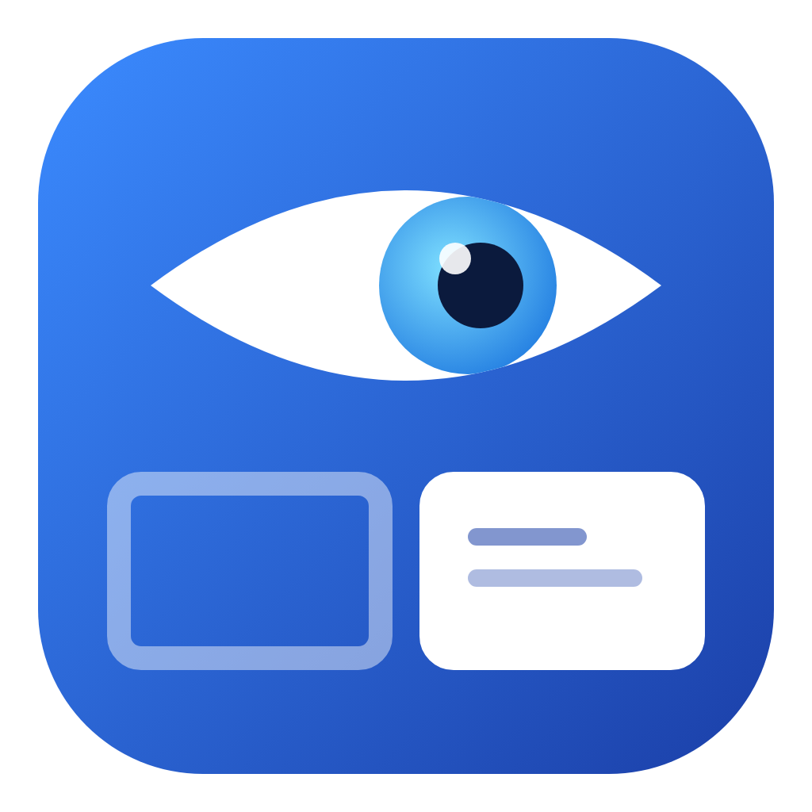
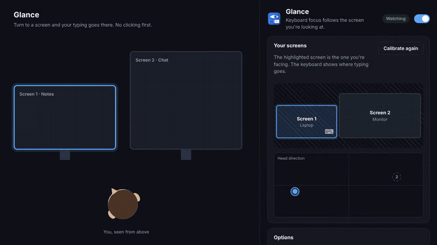
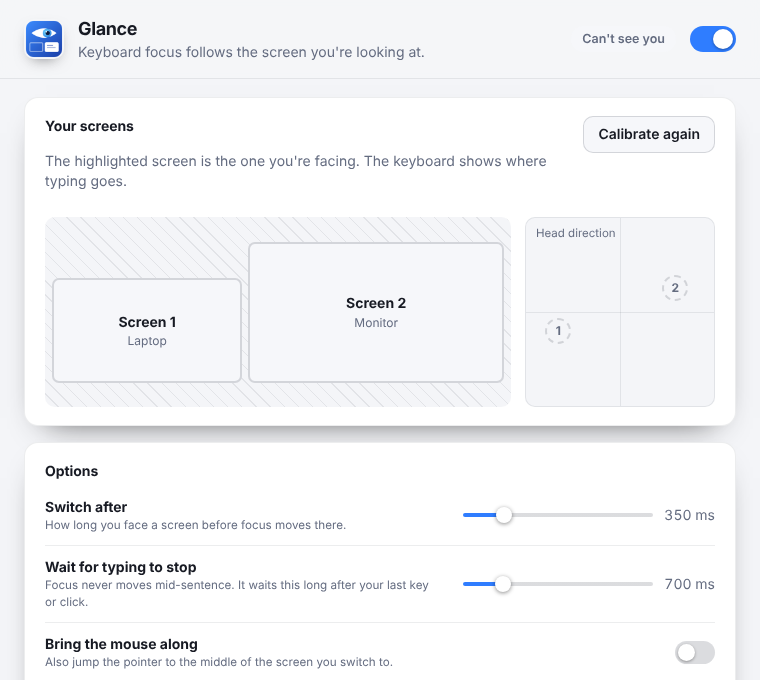
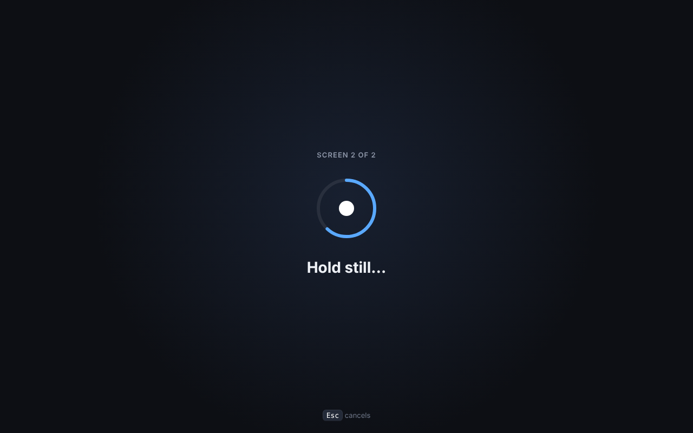
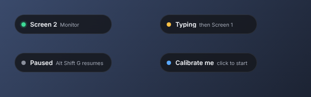

<div align="center">



# Glance

**Keyboard focus follows the screen you're looking at.**
Turn to another monitor and just start typing. No clicking first, no typing into the wrong window.
Free and open source. No account, no subscription, nothing leaves your computer.

Windows · macOS · Linux



[Demo video (MP4)](docs/demo.mp4) · [Install](#install) · [How it works](#how-it-works) · [Compared to paid apps](#compared-to-paid-focus-switching-apps)

</div>

---

## Install

**Windows** (PowerShell, installs for your user only, no admin needed):

```powershell
irm https://raw.githubusercontent.com/llamaboi55/glance/main/scripts/install.ps1 | iex
```

**macOS and Linux:**

```sh
curl -fsSL https://raw.githubusercontent.com/llamaboi55/glance/main/scripts/install.sh | sh
```

Both commands download the latest release straight from GitHub and install it. Files fetched this way don't get flagged, so there's no "unknown publisher" warning to click through. Run the same command again to update. You can also download the installer for your system from [Releases](https://github.com/llamaboi55/glance/releases/latest).

**Build it yourself** (needs [Rust](https://rustup.rs) and Node.js 18+; on Linux also the [Tauri packages](https://tauri.app/start/prerequisites/)):

```sh
git clone https://github.com/llamaboi55/glance && cd glance && npm install && npm run build
```

**Just look at it** (no install): `npm run preview`, then open the printed address. In the preview your mouse over the "Head direction" box stands in for your head.

## Getting started

1. Open Glance. Your system asks once whether it may use the camera. Say yes.
2. Press **Calibrate**. A dot appears on each screen in turn: look at it the way you normally would and press **Space**. That's about ten seconds in total.
3. Done. Turn to a screen and the front window there gets keyboard focus. A little pill in the corner shows which screen is active.



## How it works

- Your webcam sees which way your head is turned. Face tracking ([MediaPipe](https://github.com/google-ai-edge/mediapipe), running inside the app) finds a few points on your face and turns them into "how far left or right, up or down".
- Calibration remembers what that looks like for each of your screens. From then on Glance picks the screen you're facing.
- **No accidental switches.** You have to face a new screen for a moment (350 ms by default) before focus moves, so glancing at your phone or a colleague does nothing. Looking at the gap between two screens doesn't flip back and forth either.
- **Never mid-sentence.** If you're still typing or clicking, Glance waits until you pause, so no keystroke ever lands in the wrong window.
- Focus goes to the window at the front of that screen, just as if you had clicked it. Optionally the mouse pointer jumps there too.
- **Alt Shift G** pauses and resumes from anywhere (the camera turns fully off while paused). The tray icon has the same controls.





## Privacy

- Video is processed frame by frame in memory and thrown away. Nothing is recorded, saved or uploaded, and Glance never connects to the internet (the face model ships inside the app).
- Glance only knows "which way is the head pointing". It doesn't recognise who you are.
- Pause it with **Alt Shift G** and the camera turns off completely (the camera light goes out).

## Compared to paid focus-switching apps

| | Glance | Typical paid app |
|---|---|---|
| Price | Free | about $15 |
| Windows and Linux | ✅ | ❌ Mac only |
| Waits for you to stop typing | ✅ | Varies |
| Adjustable switch delay | ✅ | Some |
| Works offline, nothing uploaded | ✅ | ✅ |
| Open source | ✅ | ❌ |

## Good to know

- It's made for two or more screens with one webcam roughly in the middle or on top of your main screen. A laptop camera works fine.
- Re-calibrate if you move the camera or change how your screens are arranged. Glance notices when monitors are added or removed and asks again.
- **macOS:** the system asks for camera access the first time. Focus switching uses the public window list and needs no extra permissions.
- **Linux:** focus switching works on X11. On Wayland, apps aren't allowed to move focus to other apps, so Glance shows the active screen but can't switch for you. The camera needs the GStreamer "good" plugins, which the installer pulls in.
- **Windows:** the first time, Windows may ask whether Glance can use the camera. Focus switching works with normal windows. Some games and apps running as administrator can't be focused from a regular app.

## Development

```sh
npm install
npm run preview      # browser preview, the mouse plays your head, no Rust build needed
npm run dev          # the real app with hot reload
npm test             # head-pose and switching tests (node --test) and Rust tests
```

- `src/js/pose.js`: head direction from face points, calibration and the switching rules (tested)
- `src/js/tracker.js`: camera, MediaPipe, calibration flow and moving focus
- `src/js/settings.js`, `src/js/calibrate.js`, `src/js/pill.js`: the three windows
- `src-tauri/src/focus.rs`: finding the front window on a screen and focusing it on each system, plus "time since last keypress"
- `src-tauri/src/lib.rs`: windows, tray and shortcut

Releases are built for all three systems by GitHub Actions whenever the version in `src-tauri/tauri.conf.json` changes on `main`.

## Where the idea came from

Found through this Instagram Reel: https://www.instagram.com/p/DeSJvzUyrd_/
This project isn't affiliated with the app shown there.

## License

MIT. Third-party parts are listed in [THIRD_PARTY.md](THIRD_PARTY.md). Glance is an independent project and isn't affiliated with any other app.
